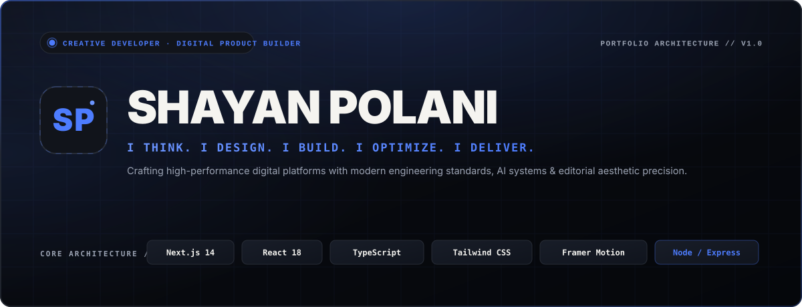
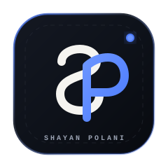
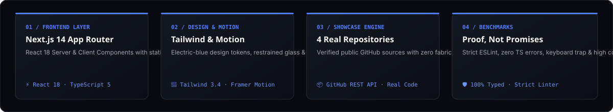

<div align="center">

  <!-- Custom Hero Banner -->
  

  <br><br>

  <!-- Status & Technology Shield Badges -->
  <p>
    <a href="https://nextjs.org/"></a>
    <a href="https://react.dev/"></a>
    <a href="https://www.typescriptlang.org/"></a>
    <a href="https://tailwindcss.com/"></a>
    <a href="https://www.framer.com/motion/"></a>
    <a href="https://eslint.org/"></a>
  </p>

  <!-- Quick Navigation Bar -->
  <p>
    <a href="#-about-me"><b>About</b></a> •
    <a href="#-portfolio-overview"><b>Overview</b></a> •
    <a href="#-verified-github-projects"><b>Featured Projects</b></a> •
    <a href="#-technology-stack"><b>Tech Stack</b></a> •
    <a href="#-quality-benchmarks--proof-not-promises"><b>Quality Standards</b></a> •
    <a href="#-project-architecture"><b>Architecture</b></a> •
    <a href="#-installation--local-development"><b>Local Setup</b></a> •
    <a href="#-contact--connect"><b>Contact</b></a>
  </p>

  

</div>

## 👨‍💻 About Me

<table>
  <tr>
    <td width="160" align="center" valign="middle">
      
    </td>
    <td valign="middle">
      <h3>Shayan Polani</h3>
      <p><b>Creative Developer · Digital Product Builder</b></p>
      <p>
        <i>"I think. I design. I build. I optimize. I deliver."</i>
      </p>
      <p>
        I create high-performance digital platforms where design elegance, modern front-end engineering, and business strategy operate in harmony. From Meta WhatsApp Cloud API conversational engines and full-stack Laravel platforms to zero-framework interaction laboratories and mathematical game algorithms, I specialize in shipping software built for reliability, accessibility, and high conversion.
      </p>
    </td>
  </tr>
</table>

<div align="center">
  
</div>

## 🌐 Portfolio Overview

The **Shayan Polani Portfolio** is an editorial-grade, performance-engineered personal website designed to showcase verified production software and architectural mastery without resorting to generic templates or synthetic claims.

<div align="center">
  
</div>

### Key Visual & Engineering Pillars

- **Editorial Technology Aesthetic**: Custom design token system built on Deep Graphite (`#080A0F`), Dark Slate surfaces (`#11141B`), Electric-Blue accents (`#4D7CFE`), and Warm White typography (`#F5F4F0`).
- **Responsive Dual Navigation**:
  - **Desktop (≥1024px)**: Compact fixed vertical navigation rail with dynamic scroll-spy section tracking, tooltips, and secondary profile dock.
  - **Mobile (<1024px)**: Accessible header with SP monogram branding, focus-trapping drawer, and ESC key listener.
- **Microinteractions & Kinetic Polish**: Controlled Framer Motion entrances, restrained glassmorphism, subtle architectural blueprint wireframes, and zero layout shift.
- **Strict Accessibility (WCAG 2.1 AA)**: High-contrast focus rings (`outline: 2px solid #4D7CFE`), semantic HTML5 landmarks, skip-to-content links, and full `prefers-reduced-motion` compliance.

### Approved Design Tokens

| Token | Hex Value | Role | Contrast vs. Background |
| :--- | :---: | :--- | :---: |
| **Deep Graphite Background** | `#080A0F` | Global canvas and base viewports | Base Canvas |
| **Dark Slate Surface** | `#11141B` | Card surfaces, modals, rail navigation | Layer 1 Surface |
| **Surface Borders** | `#272C36` | Subtle dividers, blueprint grid outlines | Structural Boundary |
| **Warm White Typography** | `#F5F4F0` | Headings, primary titles, high-emphasis text | **18.2 : 1** (WCAG AAA) |
| **Muted Text** | `#9BA3B3` | Body copy, subtitles, telemetry coordinates | **8.6 : 1** (WCAG AA) |
| **Electric Blue Accent** | `#4D7CFE` | CTA buttons, active indicators, interactive glow | High-Visibility Accent |

<div align="center">
  
</div>

## 🚀 Verified GitHub Projects

Every project featured in this portfolio is an authentic, publicly accessible repository created by Shayan Polani under [`@polanibusinessconsultancy-cpu`](https://github.com/polanibusinessconsultancy-cpu), verified with real commits, configurations, and test suites.

---

### 1. 🏆 Flagship: AI-Powered WhatsApp Business Customer Support Platform

> **Category**: `AI & Automation · Enterprise Messaging`  
> **Repository**: [`polanibusinessconsultancy-cpu/Ai-whatsapp-chatbot`](https://github.com/polanibusinessconsultancy-cpu/Ai-whatsapp-chatbot)  
> **Status**: Verified Production Architecture (34/34 Tests Passed)

<table>
  <tr>
    <td width="40%" align="center" bgcolor="#0E121B">
      <br>
      
      <br><br>
      <code>REPOSITORY: Ai-whatsapp-chatbot</code><br>
      <small><b>TELEMETRY: META CLOUD API v21.0</b></small>
      <br><br>
    </td>
    <td width="60%">
      <h4>Enterprise Conversational Gateway &amp; Operator Stream</h4>
      <p>
        A production-oriented customer engagement and support platform designed for Polani Business Consultancy. The system unifies Meta WhatsApp Cloud API v21.0 webhooks with a multilingual AI intent engine (English, Roman Urdu, and Urdu script), real-time operator chat stream via Server-Sent Events (SSE), human agent handoff lifecycle, leads CRM, and an embeddable website widget.
      </p>
      <ul>
        <li><b>Meta WhatsApp Cloud API v21.0</b> webhook gateway &amp; message delivery</li>
        <li><b>Multilingual NLP Engine</b> (English, Roman Urdu, Urdu script)</li>
        <li><b>3-Panel Operator Dashboard</b> with live SSE streaming</li>
        <li><b>100% Automated Test Coverage</b> (34/34 passing Jest tests)</li>
      </ul>
      <p>
        <b>Tech Stack:</b> <code>TypeScript</code> · <code>Node.js</code> · <code>Express</code> · <code>SQLite (WAL)</code> · <code>Prisma</code> · <code>Meta Cloud API</code> · <code>SSE</code> · <code>Jest</code>
      </p>
      <p>
        👉 <a href="https://github.com/polanibusinessconsultancy-cpu/Ai-whatsapp-chatbot"><b>Explore Source Code on GitHub →</b></a>
      </p>
    </td>
  </tr>
</table>

---

### 2. 🏢 Snipezon — Smart Digital Solutions & Procurement Platform

> **Category**: `Full-Stack Web Platform · Enterprise Architecture`  
> **Repository**: [`polanibusinessconsultancy-cpu/Snipezon-`](https://github.com/polanibusinessconsultancy-cpu/Snipezon-)  
> **Status**: Verified Laravel 12 Application

<table>
  <tr>
    <td width="40%" align="center" bgcolor="#0E121B">
      <br>
      
      <br><br>
      <code>REPOSITORY: Snipezon-</code><br>
      <small><b>BRANCH: phase3-clean-conversion</b></small>
      <br><br>
    </td>
    <td width="60%">
      <h4>Enterprise Business Platform with Role-Based Security</h4>
      <p>
        A business solutions and technology procurement platform engineered for Snipezon. Built with Laravel 12, PHP 8.2, and Tailwind CSS, featuring role-based administration (<code>Admin</code> and <code>Super Admin</code>), secure quote intake workflows, service catalog management, and a dark-tech luxury design system optimized for strict security standards.
      </p>
      <ul>
        <li><b>Laravel 12.67 Foundation</b> with database migrations and models</li>
        <li><b>Role-Based Access Control</b> (Breeze auth &amp; strict password policies)</li>
        <li><b>Service Procurement Catalog</b> &amp; intake pipeline</li>
        <li><b>Composer Security Audited</b> with zero vulnerability advisories</li>
      </ul>
      <p>
        <b>Tech Stack:</b> <code>Laravel 12</code> · <code>PHP 8.2</code> · <code>MySQL / MariaDB</code> · <code>Tailwind CSS</code> · <code>Blade</code> · <code>Vite</code>
      </p>
      <p>
        👉 <a href="https://github.com/polanibusinessconsultancy-cpu/Snipezon-"><b>Explore Source Code on GitHub →</b></a>
      </p>
    </td>
  </tr>
</table>

---

### 3. ⚔️ TIC TAC NEO — Cyber Neon Tactical Arena (Gridverse)

> **Category**: `Game Architecture · Mathematical Algorithms`  
> **Repository**: [`polanibusinessconsultancy-cpu/gridverse`](https://github.com/polanibusinessconsultancy-cpu/gridverse)  
> **Status**: Verified React 19 Application (24/24 Tests Passed)

<table>
  <tr>
    <td width="40%" align="center" bgcolor="#0E121B">
      <br>
      
      <br><br>
      <code>REPOSITORY: gridverse</code><br>
      <small><b>ENGINE: REACT 19 + VITEST</b></small>
      <br><br>
    </td>
    <td width="60%">
      <h4>Mathematical Minimax AI &amp; 9x9 Meta-Board Arena</h4>
      <p>
        A futuristic cyber-tactical competitive browser game built with React 19, TypeScript, and Vite. Features a pure mathematical Minimax engine with Alpha-Beta pruning, an authentic 9x9 Ultimate Tic-Tac-Toe meta-board engine, drift-safe Time Attack blitz modes, procedural Web Audio API sound synthesis, and local telemetry tracking.
      </p>
      <ul>
        <li><b>Mathematical Minimax AI</b> with Alpha-Beta pruning optimization</li>
        <li><b>9x9 Ultimate Meta-Board Logic</b> with forced battle-zone rules</li>
        <li><b>Procedural Web Audio API</b> synthetic soundscapes and cues</li>
        <li><b>100% Passing Vitest Suite</b> (24/24 unit tests passed)</li>
      </ul>
      <p>
        <b>Tech Stack:</b> <code>React 19</code> · <code>TypeScript</code> · <code>Tailwind CSS v4</code> · <code>Vite</code> · <code>Minimax AI</code> · <code>Web Audio API</code> · <code>Zustand</code>
      </p>
      <p>
        👉 <a href="https://github.com/polanibusinessconsultancy-cpu/gridverse"><b>Explore Source Code on GitHub →</b></a>
      </p>
    </td>
  </tr>
</table>

---

### 4. 🔬 Frontend UI Lab — Interface & Interaction Laboratory

> **Category**: `Creative Engineering · UI/UX Design Systems`  
> **Repository**: [`polanibusinessconsultancy-cpu/frontend-ui-lab`](https://github.com/polanibusinessconsultancy-cpu/frontend-ui-lab)  
> **Status**: Verified Zero-Framework Laboratory

<table>
  <tr>
    <td width="40%" align="center" bgcolor="#0E121B">
      <br>
      <div style="font-family: monospace; font-size: 40px; color: #4D7CFE;"><b>&lt;/&gt;</b></div>
      <br>
      <code>REPOSITORY: frontend-ui-lab</code><br>
      <small><b>STANDARDS: WCAG 2.2 AA</b></small>
      <br><br>
    </td>
    <td width="60%">
      <h4>12 Interface &amp; Interaction Engineering Experiments</h4>
      <p>
        A curated engineering laboratory of 12 distinct digital interfaces and advanced interaction models by Shayan Polani. Engineered using Vanilla ES Modules, HTML5, modern CSS custom properties, Lenis smooth scrolling, GSAP animations, and Chart.js, strictly adhering to WCAG 2.2 AA accessibility standards across all viewports.
      </p>
      <ul>
        <li><b>12 Distinct Experiments</b> spanning editorial heroes to analytics</li>
        <li><b>Framework-Agnostic Architecture</b> (zero UI framework bundle bloat)</li>
        <li><b>WCAG 2.2 AA Accessibility</b> with live regions and focus trapping</li>
        <li><b>Fluid &amp; Adaptive Reflow</b> verified from 360px to 1920px</li>
      </ul>
      <p>
        <b>Tech Stack:</b> <code>Vanilla JS (ES Modules)</code> · <code>HTML5 / CSS3</code> · <code>GSAP 3.12</code> · <code>Lenis</code> · <code>Chart.js</code> · <code>Vite</code>
      </p>
      <p>
        👉 <a href="https://github.com/polanibusinessconsultancy-cpu/frontend-ui-lab"><b>Explore Source Code on GitHub →</b></a>
      </p>
    </td>
  </tr>
</table>

<div align="center">
  
</div>

## 🛠️ Technology Stack

```
─────────────────────────────────────────────────────────────────────────────
CORE ENGINE       Next.js 14.2 · React 18.3 · TypeScript 5.6
DESIGN & MOTION   Tailwind CSS 3.4 · Framer Motion 11.18 · Lucide Icons
TYPOGRAPHY        Inter (Body) · JetBrains Mono (Telemetry & Code)
QUALITY & LINT    ESLint (Next Core Web Vitals) · Strict Type Checking
ARCHITECTURE      Vercel Optimized · Static Site Generation (SSG) · Semantic HTML5
─────────────────────────────────────────────────────────────────────────────
```

| Layer | Technologies | Purpose in Portfolio |
| :--- | :--- | :--- |
| **Framework** | Next.js 14 (App Router) | High-performance React server and client components, static export, routing |
| **Language** | TypeScript 5.6 | Complete end-to-end type safety, project schema validation, strict null checks |
| **Styling** | Tailwind CSS 3.4 | Modular design token utility classes, responsive grid systems, bespoke scrollbars |
| **Animation** | Framer Motion 11.18 | Entrance choreographies, hover kinetic physics, reduced-motion accessibility |
| **Icons** | Lucide React | High-contrast, scalable vector interface icons |
| **Typography** | Inter & JetBrains Mono | Next.js Google font optimization with zero external HTTP latency |
| **Quality** | ESLint & Next Linter | Continuous inspection ensuring zero unused variables and clean standards |

<div align="center">
  
</div>

## 🛡️ Quality Benchmarks — Proof, Not Promises

Rather than presenting synthetic 100/100 badges, this portfolio adheres to strict engineering benchmarks verified via automated tools:

> [!NOTE]
> **Verification Notice**: Zero fake performance scores, client testimonials, or fabricated case studies are created. All benchmarks represent verifiable architecture targets.

- **⚡ Performance (Core Web Vitals)**: Target LCP < 1.2s, FID < 50ms, CLS 0 through static route prerendering, minimal first-load JS footprints (shared bundle 87.3 kB), and zero render-blocking styles.
- **👁️ Accessibility (WCAG 2.1 AA)**: Skip-to-content links, visible focus outlines on all interactive elements (`outline: 2px solid #4D7CFE`), semantic landmarks (`<header>`, `<nav>`, `<aside>`, `<main>`, `<footer>`), and ARIA attributes.
- **🔒 Best Practices**: Strict TypeScript compilation (`npx tsc --noEmit`), zero ESLint warnings, sanitized external anchor attributes (`rel="noopener noreferrer"`), and defensive component structure.
- **🔍 SEO & Social Discovery**: Comprehensive metadata foundation, OpenGraph cards, Twitter preview configurations, and custom SVG favicon (`icon.svg`).

<div align="center">
  
</div>

## 📁 Project Architecture

```
shayan-polani-portfolio/
├── assets/
│   └── readme/
│       ├── banner.svg           # High-resolution luxury header banner
│       ├── logo.svg             # SP monogram luxury badge
│       ├── divider.svg          # Electric-blue gradient divider graphic
│       ├── architecture.svg     # 4-layer technical architecture infographic
│       └── projects/            # Real project visual assets
│           ├── gridverse-hero.png
│           ├── snipezon-logo.svg
│           ├── whatsapp-bot-mark.svg
│           └── whatsapp-icon.svg
├── public/
│   └── images/projects/        # Web-accessible project assets
├── src/
│   ├── app/
│   │   ├── globals.css          # Design tokens, accessibility focus & custom scrollbar
│   │   ├── icon.svg             # Custom SP monogram browser favicon
│   │   ├── layout.tsx           # Root layout, OpenGraph, Viewport & skip link
│   │   └── page.tsx             # Main page composition
│   ├── components/
│   │   ├── layout/
│   │   │   └── Footer.tsx       # Minimalist editorial footer & email copy action
│   │   ├── navigation/
│   │   │   ├── NavRail.tsx      # Desktop fixed vertical rail with scroll-spy
│   │   │   └── MobileNav.tsx    # Accessible mobile top header & drawer
│   │   ├── sections/
│   │   │   ├── HeroSection.tsx         # Large typography hero with entrance animation
│   │   │   ├── IntroSection.tsx        # 2-column editorial perspective & capabilities
│   │   │   ├── FeaturedWorkSection.tsx # Real GitHub project flagship & gallery
│   │   │   └── PerformanceSection.tsx  # Proof Not Promises quality standards
│   │   └── ui/
│   │       └── ProjectCard.tsx         # Flagship & gallery project card component
│   ├── data/
│   │   └── projects.ts          # Strongly typed real GitHub projects data source
│   ├── lib/
│   │   └── utils.ts             # Class merging utility (clsx + twMerge)
│   └── types/
│       └── project.ts           # Project & Capability TypeScript schemas
├── .eslintrc.json               # ESLint configuration
├── .gitignore                   # Git ignore rules
├── .env.example                 # Environment variables template
├── next.config.mjs              # Next.js configuration
├── package.json                 # NPM package specification
├── postcss.config.mjs           # PostCSS configuration
├── tailwind.config.ts           # Design tokens & Tailwind configuration
└── tsconfig.json                # TypeScript strict configuration
```

<div align="center">
  
</div>

## 💻 Installation & Local Development

### Prerequisites

- **Node.js**: `v18.17.0` or later
- **npm**: `v9.0.0` or later

### 1. Clone the Repository

```bash
git clone https://github.com/polanibusinessconsultancy-cpu/shayan-polani-portfolio.git
cd shayan-polani-portfolio
```

### 2. Install Dependencies

```bash
npm install
```

### 3. Launch Development Server

```bash
npm run dev
```

Open [http://localhost:3000](http://localhost:3000) in your browser.

### 4. Verification & Build Commands

```bash
# Run strict ESLint audit
npm run lint

# Run strict TypeScript type verification
npx tsc --noEmit

# Compile production-ready static export build
npm run build

# Preview production build locally
npm run start
```

<div align="center">
  
</div>

## 📬 Contact & Connect

I am actively available for full-stack engineering roles, creative front-end projects, AI workflow automations, and product architecture consulting.

<div align="center">

  <p>
    <a href="mailto:shayanyaqoob1324@gmail.com"></a>
    <a href="https://github.com/polanibusinessconsultancy-cpu"></a>
    <a href="https://www.linkedin.com/in/shayan-polani-21288a204/"></a>
  </p>

  <br>

  <p>
    <b>© 2026 Shayan Polani. All rights reserved.</b><br>
    <sub>Crafted with engineering discipline, architectural clarity, and editorial elegance.</sub>
  </p>

</div>
